# MPC 600 S

Sampler and sequencer OS for the **Akai MPC Sample**, based on the design of the MPC 3000 operating system: page layout, sequencer structure, timing correct and swing. Runs from the SD card via the stock autorun mechanism; the internal firmware is not modified. Remove the card to return to the stock OS.

<p align="center"></p>

## Video manual

<p align="center"><a href="https://youtu.be/MTibHXiCgGk"></a></p>

The full video manual on YouTube (53 min, in chapters): installation, sequencing, timing correct and swing, the arpeggiator, S600 programs, sampling, effects, saving and loading. **[Watch on YouTube](https://youtu.be/MTibHXiCgGk)**

## Download

| | |
|---|---|
| **[⬇ OS v1.7A (MPC-600-S-OS-v1.7A.zip)](../../releases/latest/download/MPC-600-S-OS-v1.7A.zip)** | SD-card package |
| **[⬇ Quick Start (PDF)](../../releases/latest/download/MPC-600-S-Quick-Start.pdf)** | Installation, 3 pages |
| **[⬇ Operator's Manual v1.7A (PDF)](../../releases/latest/download/MPC-600-S-Manual-v1.7A.pdf)** | Full reference |
| [⬇ Stems models (107 MB, optional)](../../releases/latest/download/MPC600S-stems.zip) | Required only by the Stems page |

Links resolve to the latest release. Earlier versions: [Releases](../../releases).

## Install

1. Extract **MPC-600-S-OS-v1.7A.zip**. Copy the `autorun` folder to the SD card root (FAT32 or exFAT). Do not rename or edit its files: the stock runner verifies `autorun.check` (SHA-256) before execution.
2. Power on with the card inserted. The stock OS boots; the MPC 600 S stops it and takes over the display and panel within 45 s of power-on.
3. Stock OS: power off, remove the card. Update: replace the `autorun` folder. User data in `MPC600S/` is not touched.

Help for the current page: **SHIFT + SAMPLE REC**. Procedure and troubleshooting: [Quick Start](../../releases/latest/download/MPC-600-S-Quick-Start.pdf).

## Specifications

| | |
|---|---|
| Sequencer | 99 sequences × 99 tracks, 96 PPQN; songs; Step Edit; Note Repeat; arpeggiator with step patterns and pattern editor |
| Timing correct | MPC 3000, MPC60, MPC 2000 and SP12 swing |
| Metronome | Click during audio takes and after Live Looper takes selectable (default off) |
| Sampling | 7–44.1 kHz, 16/12/8/4-bit, anti-alias filtered; sources: line in, INST (left channel, mono, 40 Hz HPF, 0–30 dB gain), mic, USB audio (UAC2) |
| Programs | MPC (drums); S600, taken from Akai's S-series samplers: a two-oscillator synth on each pad, envelopes, filters (incl. ladder low-pass), LFO; S600 MULTI: multisample instruments, 32 keygroups of two velocity zones, key tracking (KEY>PAN, KEY>FILTER, KEY>LEVEL, KEY>ENV) and instrument templates |
| Multisampling | Auto Sampler (you play each note; pitch detected, mapped by pitch and velocity on completion); Auto Map from file names and pitch detection (YIN); Root Auto-Detect for S600 sounds |
| Live Looper | One-pass takes dropped onto pads while the sequence keeps looping; layers without stopping; delete last take; conversion during the pass (IMMEDIATE) or after the first loop (AFTER 1ST LOOP), bit-identical either way; MIDI footswitch start/stop (AUDIO REC) |
| Footswitch | Any MIDI channel and CC, learned from one press; polarity worked out automatically (AUTO), or set |
| Recording defaults | Global start values on Additional Settings 2: sample rate (29.76 kHz; slider rates or SET to any), bit rate (12), anti-aliasing, normalize, Input Thru, mode |
| Editing | Trim, loop, zones (pad marks, equal regions, or TRANSIENT: a zone at every drum hit), warp, S-series timestretch, print effects; audio tracks; resampling |
| Stem separation | Open-Unmix UMX-HQ on device: drums, bass, vocals, music; up to 20 s per sound |
| Effects | Input, track send and pad effects (reverb, delay, modulation, drive, amp and cabinet, EQ); insert effects in any track's channel (8 slots shared across tracks, weighted by measured cost: reverb 4, amps/delays/modulation 2, EQ/dynamics/drive 1); track mixer with EQ; master EQ and compression; live CPU meter |
| Storage | Save/Load to any folder on the card; one sequence on its own; WAV export of tracks, mixes and mixdowns |
| Other machines | MIDI files (tracks chosen, onto empty tracks); MPC 1000 / 2500 / 500 sequences (.ALL, .SEQ), programs (.PGM with WAVs, start and end points) and projects (.PRJ); saving as an MPC 2500 project (.PRJ, .ALL, .PGM, WAVs) |
| Controls | Knob Mode: CATCH, JUMP or SCALE for K1–K3 and the slider |
| USB audio | Out: the full master mix (after Master FX, before the main volume) to a computer, 44.1 kHz stereo, through the device's USB audio gadget; follows the computer's clock |
| Display / audio | 320 × 240 DRM framebuffer; 44.1 kHz |
| Build | C; static aarch64 (musl) via `zig cc` |

## Screens

<table>
<tr>
<td align="center">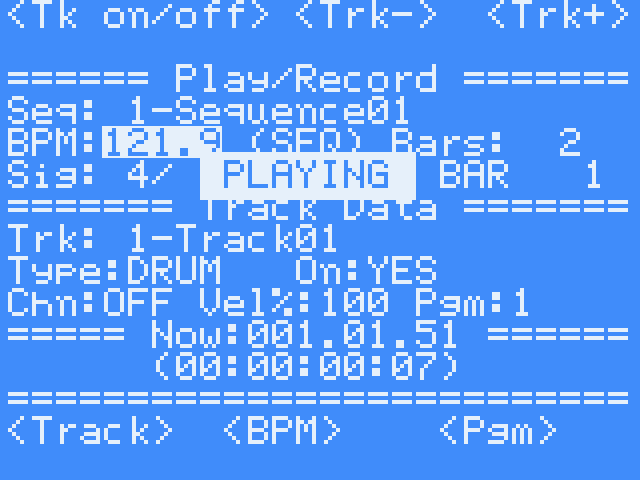<br><sub>Main page</sub></td>
<td align="center">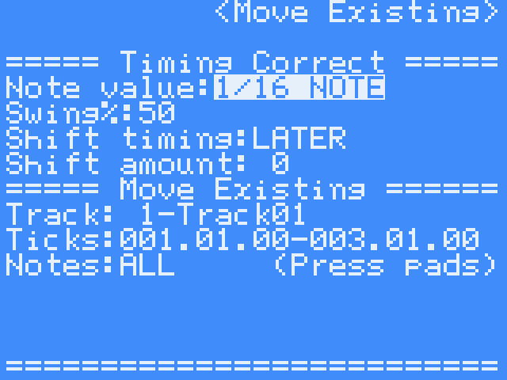<br><sub>Timing Correct and swing</sub></td>
<td align="center">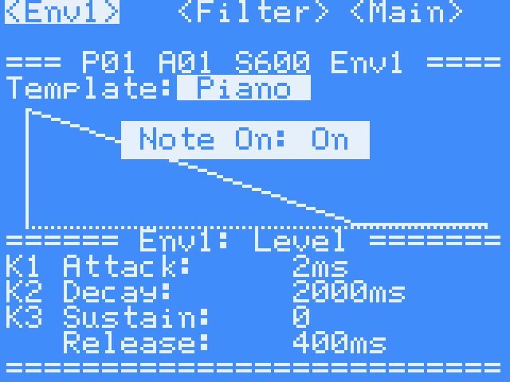<br><sub>S600: envelopes</sub></td>
</tr>
<tr>
<td align="center">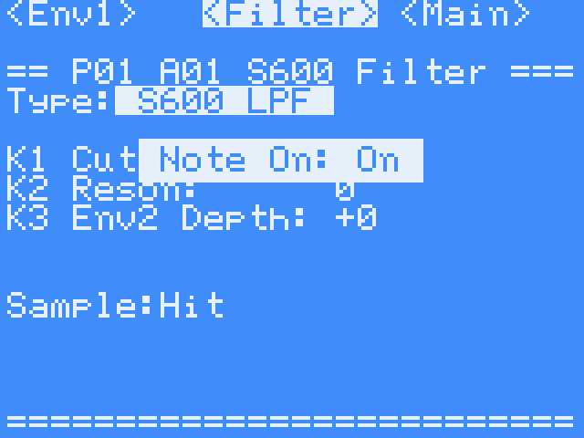<br><sub>S600: ladder filter</sub></td>
<td align="center">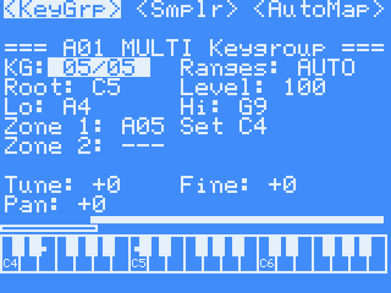<br><sub>S600 MULTI: keygroups</sub></td>
<td align="center">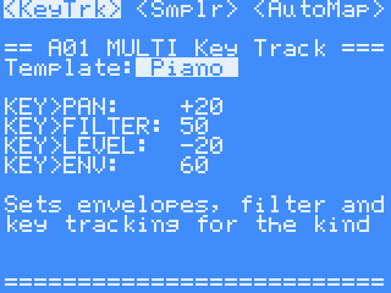<br><sub>S600 MULTI: key tracking</sub></td>
</tr>
<tr>
<td align="center">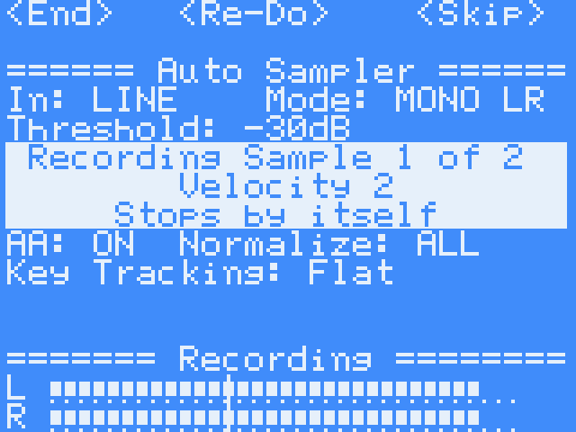<br><sub>Auto Sampler</sub></td>
<td align="center">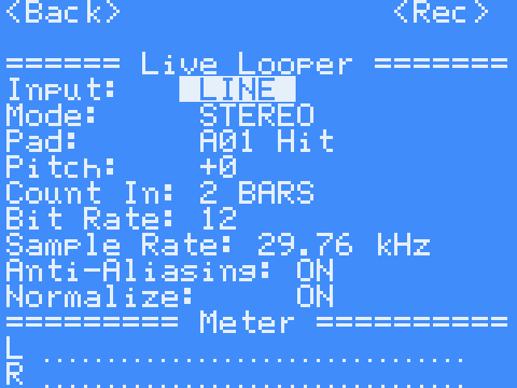<br><sub>Live Looper</sub></td>
<td align="center">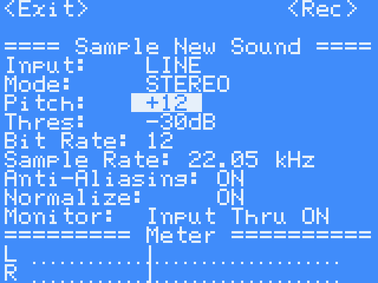<br><sub>Sample New Sound</sub></td>
</tr>
<tr>
<td align="center">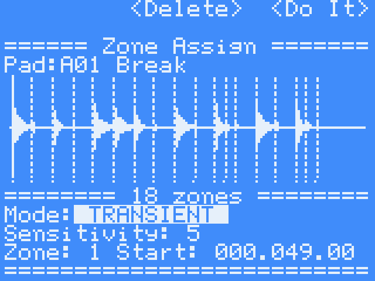<br><sub>Zone Assign: TRANSIENT</sub></td>
<td align="center">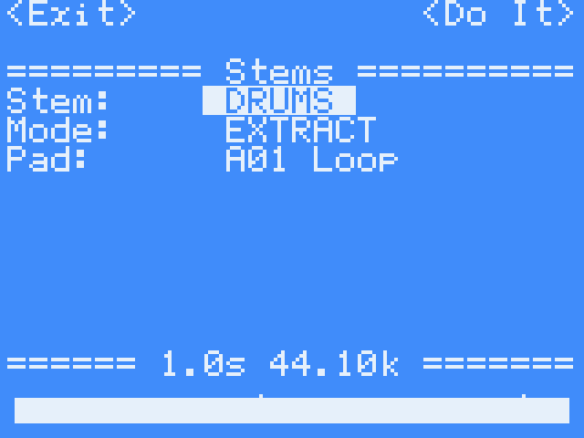<br><sub>Stem separation</sub></td>
<td align="center">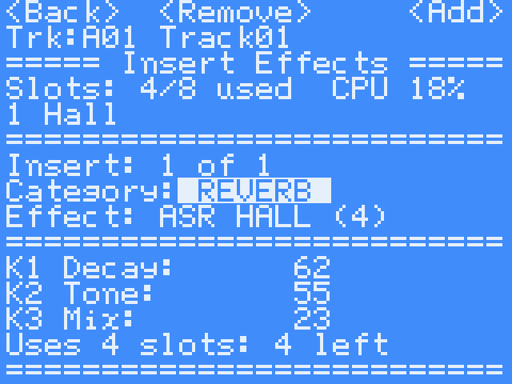<br><sub>Insert effects</sub></td>
</tr>
<tr>
<td align="center">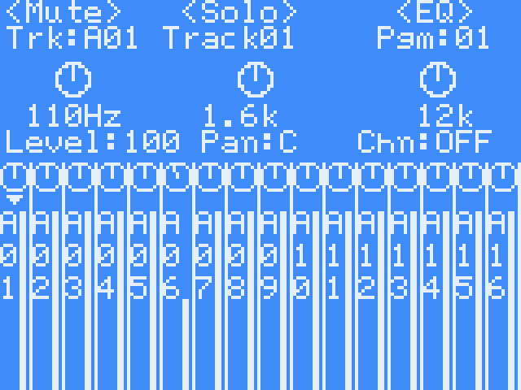<br><sub>Track mixer</sub></td>
<td align="center">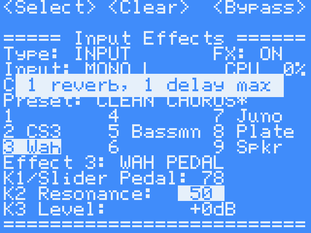<br><sub>Input effects</sub></td>
<td align="center">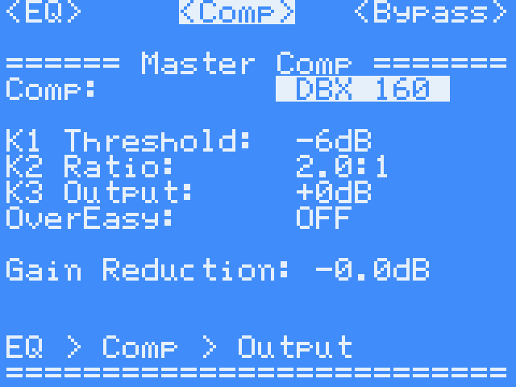<br><sub>Master effects</sub></td>
</tr>
<tr>
<td align="center">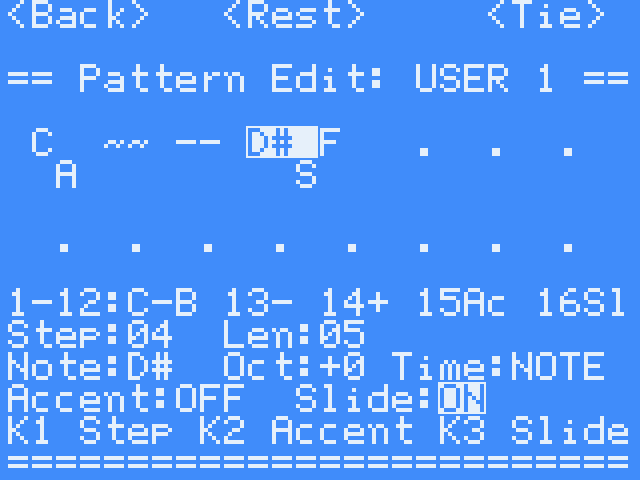<br><sub>Arpeggiator: pattern edit</sub></td>
<td align="center">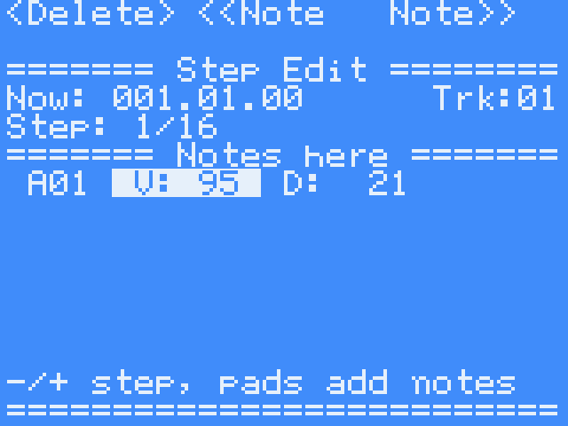<br><sub>Step Edit</sub></td>
<td align="center">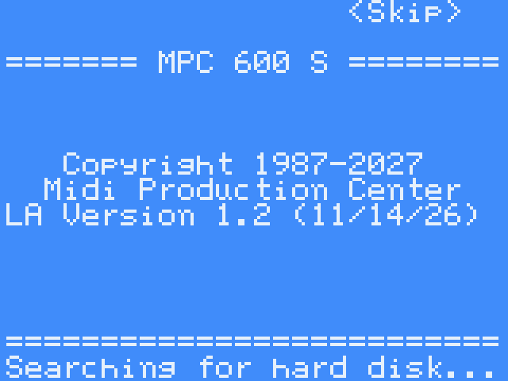<br><sub>Title</sub></td>
</tr>
</table>

## Building

Requires [Zig](https://ziglang.org/) and Python 3.

```sh
make          # bin/mpc-os and bin/mpc-os.zip (SD-card package)
make test     # host test suite
```

Manual source: `docs/manual/manual.html`; PDF via `tools/build_manual.py`. Arpeggiator presets: `tools/arp_presets.py` → `os/arp_presets.h`. Autorun packer: `tools/make_autorun.py`.

## Contact

Lanny C (LA). Questions and bug reports: doctorbnetwork@gmail.com

Video: [youtube.com/@DoctorbNetwork](https://www.youtube.com/@DoctorbNetwork)

## Licence

MIT: see [LICENSE](LICENSE).

## Credits

- Stem separation: [Open-Unmix](https://github.com/sigsep/open-unmix-pytorch) UMX-HQ (MIT). `tools/stems` generates the model files.
- MPC, MPC Sample and the S-series are trademarks of Akai Professional. This project is not affiliated with or endorsed by Akai. Machines are named only to identify the features taken from them.
